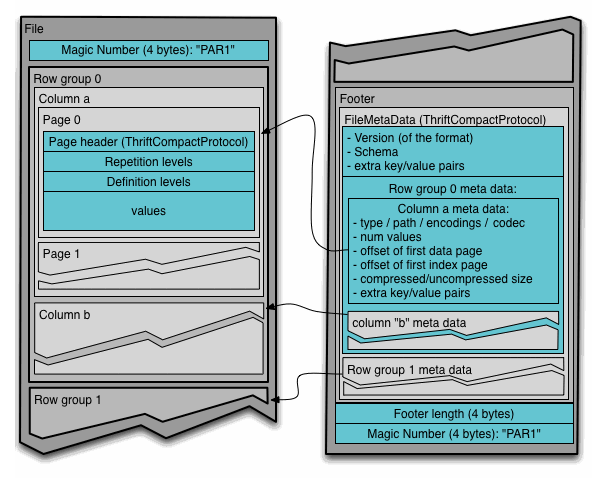

# Anatomy of a Parquet File

This is a minimal overview of Parquet. For full details, see the
[Apache Parquet documentation](https://parquet.apache.org/).

## The schema

Parquet files contain a physical data schema defining how their data columns are
encoded as bytes on disk. This schema supports arbitrary levels of nullability,
nesting (groups), and repetition (lists). These physical data types may also be
mapped to one or more *logical types*. Parquet stores all data in little endian
byte order.

There is a broader many-to-many mapping between Parquet schemas and
[Apache Arrow](https://arrow.apache.org/) schemas. Arrow supports many types
that Parquet does not, but the two share a common abstraction of columnar
storage with per-value nullability. Although they represent these concepts
differently, conversion between them is straightforward. In Parquet group nodes
are simply a name along the column's path and do not have a physical layer
in storage. In Arrow, a group's analogous struct is a node in the schema
and its own index. The same applies to list-valued columns.

## The metadata key–value pairs

<figure class="mzp-figure" markdown>

<figcaption>The Parquet file layout: row groups of column chunks, followed by a footer containing the schema, offsets, indices, and user metadata.</figcaption>
</figure>

At the end of a Parquet file is a footer containing user-defined metadata along
with the file's schema, offsets, and search indices. This user-defined metadata
is stored as key–value pairs, which makes it well suited to carrying
light-weight, immediately useful metadata that does not make sense to force into
the data columns. mzPeak uses this footer to record facet-level metadata - most
notably for the [array index](../layouts/signal-data.md#the-array-index).

## The columnar data

Parquet is a strongly typed binary columnar format with layered, blocked
compression that permits a degree of random access. It is often used in
concert with Apache Arrow's in-memory structured columnar format.

!!! warning "Support both 32-bit and 64-bit collection types in Arrow"
    Because some languages have no concept of 64-bit addresses, all
    implementations **MUST** handle both the `large_*` and non-`large_*`
    variants of collection types: `list`, `string`, and `binary`.

When stored on disk, columns are are *encoded* with one of a small list
of light-weight encodings described at <https://parquet.apache.org/docs/file-format/data-pages/encodings/>.
and then compressed using a general purpose compression codec listed at
<https://parquet.apache.org/docs/file-format/data-pages/compression/>.
Writers may need to take care when configuring column encodings because
common Parquet libraries will assume dictionary encoding is enabled and
ignore any requested encoding unless it is separately disabled. In addition,
some Parquet libraries will, if the dictionary size limit is exceeded fall back
to the "plain" encoding, which does nothing to make the data more compressible.
Dictionaries are tied to a row group, not the entire file, and will write their
values once using the "plain" encoding.

### Row groups and pages

A Parquet file is divided into **row groups**, each of which stores a horizontal
slice of every column as a **column chunk**. Column chunks are further divided
into **pages**, the smallest unit of compression and encoding. This hierarchy is
what lets a reader retrieve a narrow slice of a large file: it can locate the
row group and pages that hold the rows of interest and read only those.

Choosing row group and page sizes trades compression ratio against random-access
granularity - larger data pages compress better but make fine-grained reads
coarser as shown in the image below. Reading spectrum 5 requires decoding and decompressing
the ion mobility values for spectra 0-17, and the m/z values for spectra 0-7. Larger row
groups take (substantially) more memory to write as all constituent data pages have
to be buffered before columns are written out all at once, and can cause some dictionaries
to exceed their default size limits for highly variable values like m/z.

<figure class="mzp-figure" markdown>

<figcaption>
  The data pages of a row group over different columns show how differences in item size cause different numbers
  of entries to co-locate in the same data page.
</figcaption>
</figure>

**Recommendations**:

When size is not a substantial issue:

- 1 MB of data per data page
- 1 million rows per row group

When size is important:

- 8MB of data per data page
- 4-8 million rows per row group

!!! note
    When writing any [signal data layout](../layouts/signal-data.md), the writer **SHOULD** write each
    row with the same entity index to the same row group. This makes reading efficient as only one row
    group needs to be visited to load a single entity.

### Index levels

When writing an mzPeak archive, the writer **MUST** write a
[page index](https://parquet.apache.org/docs/file-format/pageindex/) and row group-level column
statistics. Most libraries that write Parquet support writing the page index even if
they do not themselves use it when reading.

The row group-level column statistics stores the minimum and maximum values in the column across
the entire row group. These are useful for deciding if the reader needs to even visit a row group,
saving read planning effort, and are easily accessible to all Parquet implementations. Scanning these
statistics is a good and cheap way to determine things like the minimum and maximum m/z observed,
the time range covered in the run, or the highest MS level used.

The page index records per-data page minimum and maximum values, which is what makes predicate-driven
reads (for example, "only pages whose `spectrum_index` covers 5000–5100") efficient. Not all Parquet
libraries have reliable access to the page index yet.

Parquet also supports storing a bloom filter per column per row group, but this is usually disabled by
default. A bloom filter's size-to-false positive ratio makes them expensive to use for highly variable
values, and they are needless for columns with very high repetition when reading them is inexpensive.
For very, very large metadata tables, it may still be useful to use them for tracking string values like
the `spectrum.id` or `precursor.activation.dissociation_method` columns. Writers **MAY** choose to write
bloom filters, but readers **MUST** be prepared to read data without them.
