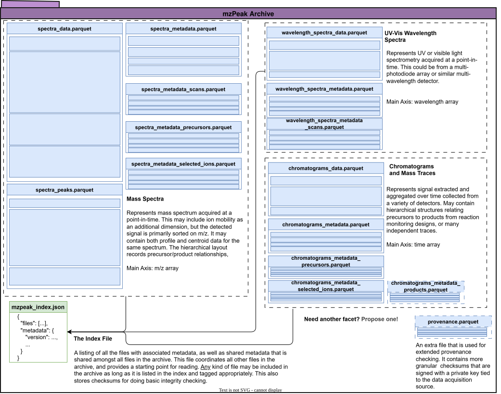
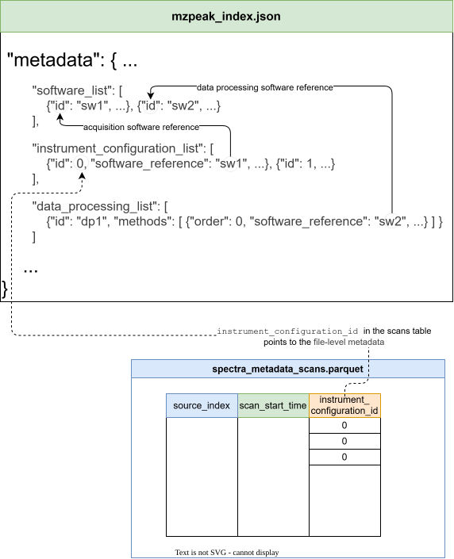
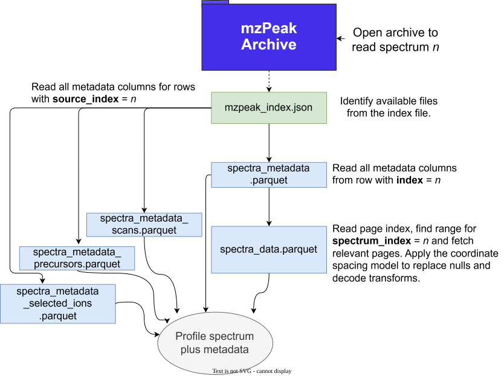

# Overview

mzPeak is an open, next-generation file format for mass spectrometry data.
Advances in MS instrumentation - higher resolution, faster scan rates, greater
sensitivity, and the growing use of ion mobility and imaging - have sharply
increased the volume and dimensionality of the data produced in proteomics,
metabolomics, and lipidomics. Established open formats such as mzML and imzML
increasingly struggle with the resulting file sizes, data-access patterns, and
metadata demands, while vendor-specific formats offer faster access at the cost
of interoperability and long-term archival stability. mzPeak is designed to
address these needs as a community standard; the motivation and design rationale
are set out in the accompanying white paper
[(1)](../reference/references.md) and summarised under
[Motivation](motivation.md).

The format takes a hybrid approach: an archive of
[Apache Parquet](https://parquet.apache.org/) tables - packaged in an
uncompressed ZIP container, or an unpacked directory, together with a small JSON
index - that stores numerical signal data as compact, columnar binary while
keeping metadata both human- and machine-readable and anchored in the
[PSI-MS controlled vocabulary](https://www.ebi.ac.uk/ols4/ontologies/ms).
Building on the widely available Apache Parquet and Apache
Arrow libraries rather than a single core implementation, the on-disk structure
is language-independent. Uncompressed archive members and a required Parquet page
index let a reader locate and decode a single spectrum without parsing an entire
run, the basis for random access from local disk, object storage, or over HTTP.
This document specifies that format: its container, signal-data layouts, index
file, and metadata model.

While mzPeak draws on prior art like [mzML](https://www.psidev.info/mzML), it is
not a direct re-implementation of mzML in a Parquet table. It re-uses concepts
such as controlled vocabularies where feasible, alongside arbitrary additional
user metadata. For the conventions used in the normative text, see
[Notational Conventions](conventions.md).

## Components of an archive

- **`mzpeak_index.json`** - definition of the files present in the archive,
  encoded as JSON. Resolving files by controlled terms is easier than matching
  file names. See [The Index File](../archive/index-file.md).
- **`spectra_metadata.parquet`** - spectrum-level descriptions using the [metadata table](../layouts/metadata-tables.md) layout.
- **`spectra_metadata_scans.parquet`** - spectrum-level descriptions of scans using the [metadata table](../layouts/metadata-tables.md) layout.
- **`spectra_metadata_precursors.parquet`** - spectrum-level descriptions of precursors using the [metadata table](../layouts/metadata-tables.md) layout.
- **`spectra_metadata_selected_ions.parquet`** - spectrum-level description of selected ions using the [metadata table](../layouts/metadata-tables.md) layout.
- **`spectra_data.parquet`** - spectrum **profile** signal data, in [point layout](../layouts/point-layout.md) or [chunked layout](../layouts/chunked-layout.md),
  which have different size and random-access characteristics.
- **`spectra_peaks.parquet`** - spectrum **centroids**, stored explicitly separately from the profile signal in `spectra_data.parquet`. This
  is how mzPeak holds both profile and centroid versions of the same spectra. This file may not always be present. It may use either [point layout](../layouts/point-layout.md) or [chunked layout](../layouts/chunked-layout.md) as well.
- **`chromatograms_metadata.parquet`** - chromatogram-level description metadata using the [metadata table](../layouts/metadata-tables.md) layout.
- **`chromatograms_metadata_precursors.parquet`** - chromatogram-level description of precursors using the [metadata table](../layouts/metadata-tables.md) layout.
- **`chromatograms_metadata_selected_ions.parquet`** - chromatogram-level description of selected ions the [metadata table](../layouts/metadata-tables.md) layout.
- **`chromatograms_data.parquet`** - chromatogram signal data, in point or chunked layout. Intensity measures with different units may be stored in parallel. May use either of the [point layout](../layouts/point-layout.md) or [chunked layout](../layouts/chunked-layout.md)

Other Parquet files may be added to cover additional modalities as needed, such as [wavelength spectra](../schemas/wavelength-spectra.md). Additional files
of all sorts are permitted, as long as they are included in the [index file](../archive/index-file.md).

### How file-level metadata is cross-referenced

The index file stores file-level metadata that describes the entire run, a heterogenous collection of entities with small multiplicity but
high levels of nesting. This information is inexpensive to parse and can be useful for quickly determining if an mzPeak archive has facets
of interest before committing to parsing one or more of the Parquet tables.

<figure markdown="block">

<caption>
How the file-level metadata is cross-referenced
</caption>
</figure>

Some Parquet tables reference file-level metadata, like the `spectra_metadata_scans.parquet` table shown above referencing
the `instrument_configuration_list` in the file-level metadata to say which instrument configuration was used to acquire a
particular scan.

### Reading the *n*th spectrum

